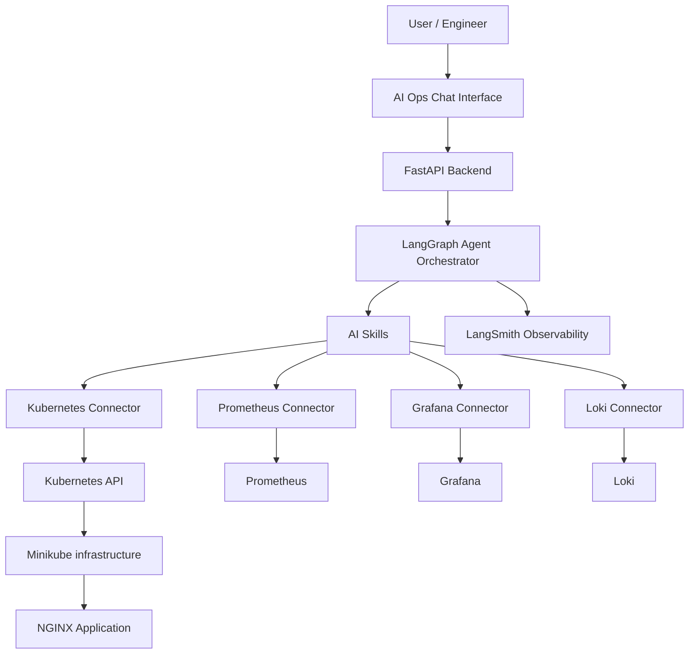

# AI Ops Assistant - Intelligent Kubernetes Operations Platform

An AI-powered operations assistant designed to monitor, troubleshoot, investigate and manage Kubernetes infrastructure using Large Language Models (LLMs), AI agents and observability tools.
The platform combines **Kubernetes, Prometheus, Grafana, Loki, LangChain, LangGraph and LangSmith** to deliver intelligent infrastructure monitoring, automated incident investigation and controlled remediation.

---

## Project Overview 
Traditional infrastructure monitoring tools provide metrics, dashboards and alerts, but engineers still need to investigate incidents manually.
The AI Ops assistant aims to bridge this gap by introducing an intelligent agent that can understand natural language questions, interact with infrastructure monitoring systems, investigate operational issues and recommend corrective actions.
Instead of manually checking multiple dashboards and logs, engineers can ask questions such as:
- Why is my NGINX application slow?
- Which Kubernetes pods are consuming most memory?
- Why did my NGINX pod restart?
- Are there any failing Prometheus targets?
- Investigate why my application is unavailable?
- Can you restart the unhealthy deployment?

The assistant uses specialized skills, connectors and plugins to investigate infrastructure issues.

## Architecture



## Technology Stack
| Category | Technology | Purpose |
| --- | --- | ---|
| Container orchestration | Kubernetes | Infrastructure management |
| Local Kubernetes | Minikube | Development environment |
| Containers | Docker | Containerization |
| AI framework | LangChain | LLM and tool integration |
| Agent orchestration | LangGraph | Multi-step agent workflows |
| LLM observability | LangSmith | Tracing and evaluation |
| LLM | OpenAI | Reasoning and natural language |
| Backend | Python/FastAPI | API and application backend |
| Metrics | Prometheus | Infrastructure and monitoring |
| Visualization | Grafana | Monitoring dashboards |
| Logging | Loki | Centralized log management|
| Integration | MCP | Extensible tool connectivity |

## AI Agent
The assistant uses reusable operational skills rather than relying on a single generic chatbot.
| Skill | Description |
| -- | -- |
| Kubernetes Resource Analysis | Analyze CPU, memory and pod resource consumption |
| Kubernetes Troubleshooting | Analyze NGINX performance and HTTP errors |
| Prometheus Health Check | Investigate scrape targets and monitoring health |
| Performance Analysis | Identify infrastructure bottlenecks |
| Incident Investigation | Correlate logs, metrics and Kubernetes events |
| Kubernetes Remediation | Perform approved infrastructure operations |

## Connectors and Integrations
The platform uses connectors to interact with infrastructure and monitoring systems.
- **Kubernetes Connector:** Interact with pods, deployments, services and events.
- **Prometheus Connector:** Query infrastructure and application metrics using PromQL.
- **Grafana Connector:** Access dashboards and alert information.
- **Loki Connector:** Search application and infrastructure logs.
- **MCP Connector:** Expose tools through a standardized integration protocol.

## Observability Architecture
The project has two observability layers.
### Infrastructure Observability
Prometheus, Grafana and Loki provide visibility into:
- Kubernetes node health.
- Pod CPU and memory utilization.
- Container restarts.
- NGINX request rates.
- Application errors.
- Infrastructure logs.

### LLM Observability
LangSmith provides visibility into the AI assistant itself:
- LLM execution traces.
- Agent workflow execution.
- Tool invocation history.
- Model latency.
- Execution failures.
- Agent evaluation and response quality.

## Example Use Cases

### 1\. NGINX Performance Investigation
**User:** "Why is my NGINX application slow?"

**Assistant workflow:**
1. Inspect NGINX pod health.
2. Query Prometheus metrics.
3. Analyze HTTP request rates.
4. Inspect application logs.
5. Correlate infrastructure metrics.
6. Generate an investigation report.

### 2\. Kubernetes Memory Analysis
**User:** "Which pods are consuming the most memory?"

The assistant queries Kubernetes and Prometheus, ranks pods by memory consumption and reports the results.

### 3\. Pod Restart Investigation
**User:** "Why did my NGINX pod restart?"

The assistant investigates:
- Pod restart counts.
- Kubernetes events.
- Container termination reasons.
- Previous container logs.
- Memory and CPU metrics.

  ### 4\. Infrastructure Remediation
  **User:** "Restart the unhealthy NGINX deployment."

   The assistant verifies the target, explains the proposing action and requests approval before executing the operation.

  ## Project Structure

  ```text
  ai-ops-assistant/
  1. backend/
      -app/
          -main.py
          -config.py
          -agents/
              *orchestrator.py *router.py *state.py
          -skills/
              *kubernetes/ *prometheus/ *nginx/ *incident/
          -connectors/
              *kubernetes/ *prometheus.py *grafana.py *loki.py
          -tools/
          -observability/
              *langsmith.py
      -requirements.txt
      -Dockerfile
  2. frontend/
      -React application
  3. infrastructure/
      -nginx/
      -monitoring/
      -loki/
      -aiops/
  4. tests/
  5. README.md
  ```

  ## Getting Started

  ### Prerequisites

  - Docker
  - Minikube
  - kubectl
  - Helm
  - Python 3.11+
  - OpenAI API key
  - LangSmith API key
 
### 1.\ Start Minikube

```bash
minikube start --driver=docker
```

Verify the cluster:
```bash
kubectl get nodes
```

### 2.\ Deploy NGINX

```bash
kubectl create namespace nginx

kubectl create deployment nginx \
  --image=nginx:latest \
  --replicas=2 \
  --n nginx
```


