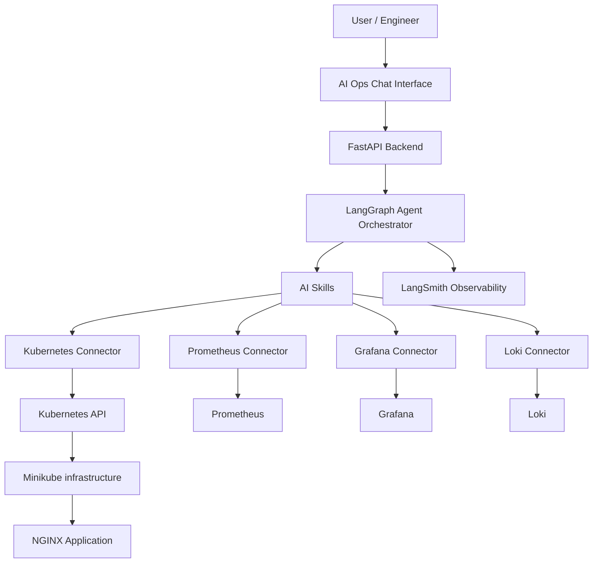

# AI Ops Assistant - Intelligent Kubernetes Operations Platform

An AI-powered operations assistant designed to monitor, troubleshoot, investigate and manage Kubernetes infrastructure using Large Language Models (LLMs), AI agents and observability tools.
The platform combines **Kubernetes, Prometheus, Grafana, Loki, LangChain, LangGraph and LangSmith** to deliver intelligent infrastructure monitoring, automated incident investigation and controlled remediation.

---

## Project Overview 
Traditional infrastructure monitoring tools provide metrics, dashboards and alerts, but engineers still need to investigate incidents manually.
The AI Ops assistant aims to bridge this gap by introducing an intelligent agent that can understand natural language questions, interact with infrastructure monitoring systems, investigate operational issues and recommend corrective actions.
Instead of manually checking multiple dashboards and logs, engineers can ask questions such as:
-Why is my NGINX application slow?
-Which Kubernetes pods are consuming most memory?
-Why did my NGINX pod restart?
-Are there any failing Prometheus targets?
-Investigate why my application is unavailable?
-Can you restart the unhealthy deployment?

The assistant uses specialized skills, connectors and plugins to investigate infrastructure issues.

## Architecture

## Technology Stack
| Category | Technology | Purpose |
| --- | --- | ---|
| Container orchestration | Kubernetes | Infrastructure management |
